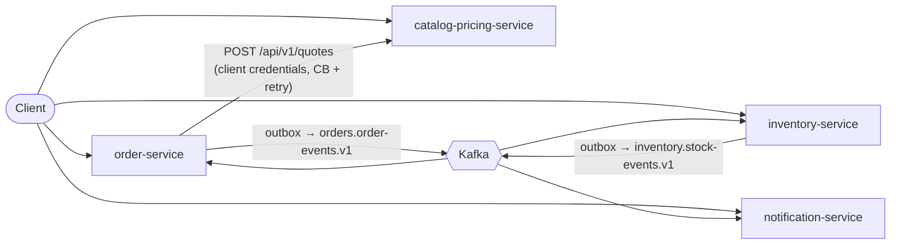

# OrderFlow

OrderFlow is a B2B/B2C e-commerce backend made of four services: three Spring Boot services and one Micronaut service. They talk over REST and Kafka. It is a learning and portfolio project built in production style: transactional outbox, idempotent consumers, a choreography saga, OAuth2/JWT security, resilience, structured logs, tracing, metrics, container images, CI and a Terraform definition for AWS ECS Fargate.

[docs/ARCHITECTURE.md](docs/ARCHITECTURE.md) is the source of truth for the design, APIs and event contracts.

**Status:**
- **Verified locally:** the whole system runs and is verified locally:
  - unit and integration tests against real PostgreSQL, Kafka and Redis (Testcontainers);
  - Docker image checks;
  - a full Docker Compose stack test with an order-to-email scenario.
- **Prepared, not yet run:** the AWS infrastructure and the GitHub Actions release workflow are implemented and checked with mock-provider and contract tests. They have not yet been applied to a live AWS account or run on hosted GitHub runners.

## Services

| Service | Stack | Port | Responsibility |
|---|---|---|---|
| `catalog-pricing-service` | Spring Boot 4.1, JPA, Redis | 8081 | Products, customer groups and quantity price tiers; price quotes with a Redis cache |
| `order-service` | Spring Boot 4.1, JPA, Redis, Kafka | 8082 | Order placement with HTTP idempotency, queries, cancellation; drives the order saga |
| `inventory-service` | Spring Boot 4.1, JDBC, Kafka | 8083 | Stock and all-or-nothing reservations; publishes reservation results and low-stock alerts |
| `notification-service` | Micronaut 5.2, Micronaut Data JDBC, Kafka | 8084 | Turns events into customer and operations notifications; SMTP locally, log channel on AWS |

Each service owns one PostgreSQL schema with Flyway migrations and never reads another service's schema.

## How it works



### Placing an order

1. **Quote and store.** `POST /api/v1/orders` requires a customer token and an `Idempotency-Key` header.
   - The order service asks the catalog for a quote, outside any database transaction.
   - It then stores the `PENDING` order and an `OrderPlaced` outbox row in one transaction, and returns `202 Accepted`.
2. **Publish.** A relay publishes outbox rows to Kafka in order per aggregate. A poison row is parked so it cannot block the rows behind it.
3. **Reserve.** The inventory service reserves stock for all lines or none (a conditional `UPDATE`, so stock is never oversold). It answers with `StockReserved` or `StockReservationFailed`, again through its own outbox.
4. **Settle.** The order service confirms or rejects the order. The notification service emails the customer.
   - Cancelling an order releases its reservations.
   - Orders still `PENDING` after 15 minutes are cancelled by a scheduled sweep.

### Design choices

| Concern | Implementation |
|---|---|
| Event publication | Transactional outbox in order and inventory; business code never calls Kafka directly |
| Duplicate delivery | Every consumer is idempotent through a `processed_event` table written in the same transaction |
| Failed events | Bounded retries with backoff, then a per-consumer-group dead-letter topic (`<topic>.<group>.DLT`) with Spring-compatible headers; [`scripts/dlt-replay.sh`](scripts/dlt-replay.sh) replays them |
| HTTP idempotency | Redis claim with a short in-progress lease plus a durable idempotency key on the `orders` table, so a Redis outage cannot create a duplicate order |
| Synchronous call | Order → catalog quote with 1 s / 2 s timeouts, retry on connect errors and 5xx, and a circuit breaker (Resilience4j) |
| Security | Keycloak issues JWTs. Roles: `CUSTOMER` (own orders only; the customer ID comes from the token) and `ADMIN`. The quote endpoint accepts only the order service's client-credentials token |
| Errors | RFC 9457 ProblemDetail responses with stable relative types such as `/problems/validation`, from one `@RestControllerAdvice` per service |
| Retention | Outbox rows 7 days, dedup and cancelled-order markers 14 days, Kafka topics 7 days; batched, ShedLock-guarded cleanup jobs |
| Concurrency | Virtual threads on the Spring services; fixed Hikari pools; one consumer thread per partition |

## Tech stack

- **Languages and frameworks:** Java 25, Spring Boot 4.1, Micronaut 5.2, Maven Wrapper.
- **Data and messaging:** PostgreSQL 17 with Flyway, Redis 7.4, Apache Kafka 4.3 (KRaft).
- **Security and resilience:** Keycloak 26 (OAuth2/OIDC), Resilience4j, ShedLock.
- **Observability:** Micrometer with Prometheus endpoints, Micrometer Tracing with W3C trace context, ECS JSON logs.
- **Testing:** JUnit 5, AssertJ, Mockito, Testcontainers, WireMock, Awaitility.
- **Delivery:** Docker multi-stage images, Docker Compose, GitHub Actions, and Terraform for AWS (ECS Fargate, RDS, ALB, ECR, Service Connect).

## Run it locally

You need Docker Desktop, and JDK 25 if you want to build or test outside containers.

```bash
cp infra/.env.example infra/.env          # first time only; replace the placeholder passwords
docker compose --env-file infra/.env -f infra/docker-compose.yaml up --build -d --wait
```

Compose starts the four applications together with PostgreSQL, Redis, Kafka, Kafka UI, Mailpit and Keycloak.
- **Ports:** every published port binds to `127.0.0.1`.
- **Container sizing:** applications get the same memory limits as on ECS (768 MiB for Spring, 512 MiB for notification). The JVM uses 45% of that limit as heap, and two malloc arenas (`MALLOC_ARENA_MAX=2`) keep native memory stable between runs.

| Address | What |
|---|---|
| `localhost:8081` … `:8084` | catalog, order, inventory, notification |
| `http://localhost:8180` | Keycloak (realm `orderflow`) |
| `http://localhost:8025` | Mailpit inbox |
| `http://localhost:8085` | Kafka UI |
| `localhost:5433` / `:6379` / `:9094` | PostgreSQL / Redis / Kafka host listener |

### Try it

The realm has demo users `consumer.one`, `consumer.two`, `standard` and `gold` (customers) and `admin`. All of them use `DEMO_USER_PASSWORD` from `infra/.env`.

```bash
source infra/.env
TOKEN=$(curl -s -d grant_type=password -d client_id=orderflow-cli -d username=standard \
  --data-urlencode "password=$DEMO_USER_PASSWORD" \
  http://localhost:8180/realms/orderflow/protocol/openid-connect/token | jq -r .access_token)

curl 'http://localhost:8081/api/v1/products?category=FURNITURE&size=3'      # public
curl -i -X POST http://localhost:8082/api/v1/orders -H "Authorization: Bearer $TOKEN" \
  -H 'Idempotency-Key: demo-1' -H 'Content-Type: application/json' \
  -d '{"lines":[{"sku":"CHAIR-001","quantity":2}]}'                          # 202, PENDING
curl -H "Authorization: Bearer $TOKEN" http://localhost:8082/api/v1/orders  # CONFIRMED shortly after
```

The confirmation email appears in Mailpit. [`scripts/smoke.sh`](scripts/smoke.sh) runs the full scenario:
- B2C and B2B pricing;
- idempotency;
- confirmation, stock rejection and cancellation;
- notifications.

```bash
MAILPIT_URL=http://localhost:8025 scripts/smoke.sh
```

Each Spring service serves OpenAPI at `/v3/api-docs` and Swagger UI at `/swagger-ui.html`.

To run a service from the IDE instead, stop its container and start it with the Spring `local` profile or the Micronaut `local` environment. Pass the variables from `infra/.env` (`POSTGRES_PASSWORD`; the order service also needs `ORDER_SERVICE_CLIENT_SECRET`).

```bash
cd services/order-service && ./mvnw spring-boot:run -Dspring-boot.run.profiles=local
```

## API overview

| Method and path | Access |
|---|---|
| `GET /api/v1/products`, `GET /api/v1/products/{sku}` | public |
| `POST /api/v1/products`, `PUT /api/v1/products/{sku}/prices` | `ADMIN` |
| `POST /api/v1/quotes` | order service client credentials (scope `pricing.quote`), internal only |
| `POST /api/v1/orders` (requires `Idempotency-Key`) | `CUSTOMER` |
| `GET /api/v1/orders/{id}`, `GET /api/v1/orders?customerId=&status=&page=&size=`, `POST /api/v1/orders/{id}/cancel` | `CUSTOMER` (own orders) or `ADMIN` |
| `GET /api/v1/stock/{sku}`, `PUT /api/v1/stock/{sku}`, `GET /api/v1/reservations?orderId=` | `ADMIN` |
| `GET /api/v1/notifications?orderId=` | `ADMIN` |

Request and response details, status codes and the event envelope are in [ARCHITECTURE §4–5](docs/ARCHITECTURE.md). The event samples are in [`contracts/events/`](contracts/events/).

## Tests

```bash
./mvnw verify                                             # all four services
cd services/<service> && ./mvnw verify                    # one service
```

- **Service tests (JUnit):** about 540 tests in total.
  - Domain logic has plain unit tests.
  - Web and JPA slices use `@WebMvcTest` and `@DataJpaTest`.
  - Integration tests run against real PostgreSQL, Kafka, Redis and Keycloak containers. There is no H2 and no embedded Kafka.
- **Notable tests:**
  - a 50-thread oversell test;
  - outbox ordering under row locks;
  - consumer idempotency and DLT routing;
  - trace propagation across HTTP and Kafka;
  - producer contract tests against the samples in `contracts/events/`;
  - a query-count test against N+1;
  - `EXPLAIN (GENERIC_PLAN)` checks that the order-list queries use their indexes.
- **Infrastructure and delivery checks** (Python `unittest`):
  - [`scripts/tests_docker`](scripts/tests_docker): images, Kafka topic init, Keycloak image, DLT replay;
  - [`scripts/tests_compose`](scripts/tests_compose): the full Compose stack, the order-to-email scenario and a 50-order oversell run;
  - [`scripts/tests_ci`](scripts/tests_ci) and [`scripts/tests_deploy`](scripts/tests_deploy): workflow contracts and the deploy helper;
  - `infra/terraform/tests`: Terraform mock-provider tests.

Integration tests need a running Docker daemon.

## Observability

- **Logs:** Spring services log ECS JSON; notification logs Logback JSON. Logs carry trace and span IDs and no personal data beyond IDs.
- **Tracing:** W3C trace context flows over HTTP, is stored with each outbox row and continues through Kafka consumers.
- **Metrics:** `/actuator/prometheus` (Spring) and `/prometheus` (notification) expose:
  - business counters (`orders_placed_total`, `orders_rejected_total`, `inventory_reservation_failed_total`);
  - `outbox_lag_seconds` and `outbox_parked`;
  - `messaging_dead_letters_total`;
  - the age of the oldest pending order;
  - Resilience4j, cache, Hikari and Kafka consumer metrics.
- **Health:** liveness and readiness probes per service. Readiness covers the database; Redis and Kafka appear in the full health endpoint.

## Deployment (AWS)

[`infra/terraform`](infra/terraform/README.md) defines the AWS runtime:
- ECR repositories;
- seven ARM64 ECS Fargate services: the four applications, Kafka, Redis and Keycloak, connected through Service Connect;
- an RDS PostgreSQL instance with its password managed in Secrets Manager and `sslmode=verify-full`;
- an HTTP ALB restricted to configured source networks.

The manual GitHub Actions release, documented in [docs/DEPLOYMENT.md](docs/DEPLOYMENT.md):
- authenticates with GitHub OIDC;
- publishes immutable SHA-tagged ARM64 images in parallel;
- deploys verified ECS revisions;
- supports per-service rollback.

CI runs on pull requests and on `main`. Path filters select the affected services; see [docs/CI.md](docs/CI.md).

## Repository layout

```text
services/            four services, each a standalone Maven project with Dockerfile
contracts/events/    canonical JSON samples of every event (the shared contract)
infra/               docker-compose.yaml, Keycloak realm and image, Terraform
scripts/             smoke, oversell, DLT replay, benchmarks, deploy helper and their tests
docs/                ARCHITECTURE, CI and DEPLOYMENT
.github/workflows/   CI and release workflows
```

## Known limitations

This is a demo deployment. These trade-offs are deliberate and documented in ARCHITECTURE ("Demo security trade-offs"):
- **Database user:** one database user for all services.
- **Kafka and Redis:** both run without authentication inside the task network.
- **Personal data:** customer emails travel inside event payloads.
- **Infrastructure:**
  - HTTP-only ALB;
  - single-AZ RDS without backups;
  - a single Kafka broker and Redis node.

The AWS stack and the release workflow have not yet run against a live account.
