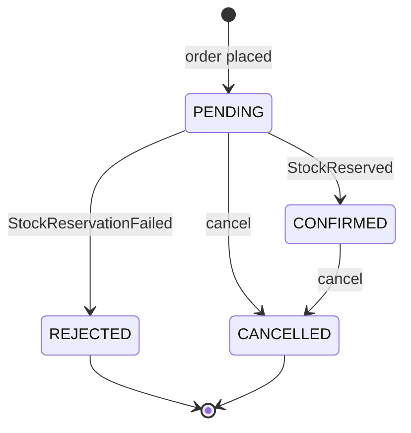
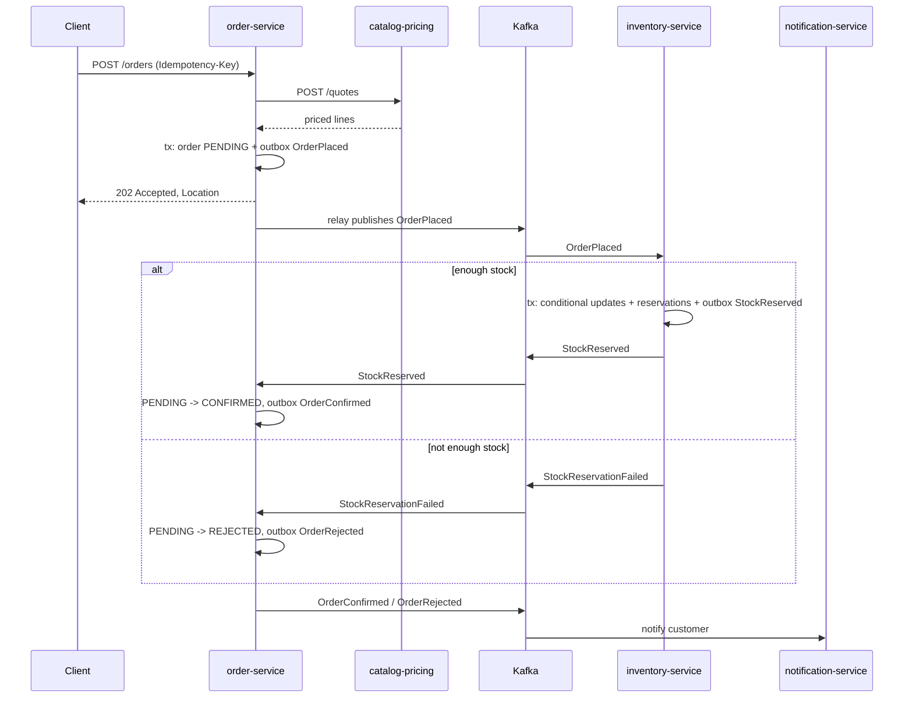

# OrderFlow – Architecture

Target architecture for a B2B/B2C e-commerce backend with four independently deployable services. The scope is intentionally limited to catalog, ordering, inventory and notifications.

## 1. Scope

In scope:

- Product catalog with B2C list prices and B2B customer-group price lists with volume tiers
- Order placement with idempotency, asynchronous stock reservation and cancellation
- Inventory that never oversells under concurrent load
- Customer notifications driven by events
- Local run with Docker Compose, CI on GitHub Actions, a real (temporary) deployment to AWS ECS Fargate
- OAuth2/JWT with Keycloak: customer and admin roles, service-to-service client credentials (local Compose; AWS identity provider is a later step)

Out of scope (deliberately): payments, shipping, UI, search, multi-currency conversion.

## 2. Tech stack

| Area | Choice | Notes |
|---|---|---|
| Language | Java 25 (LTS) | Micronaut 5 requires Java 25, so all services use it |
| Main framework | Spring Boot 4.1.x | catalog-pricing, order, inventory |
| Second framework | Micronaut 5.x | notification-service |
| Build | Maven (wrapper per service) + root aggregator pom | |
| Database | PostgreSQL 17, one schema per service, Flyway migrations | |
| Persistence | Spring Data JPA / Hibernate; Micronaut Data JDBC | |
| Cache / keys | Redis 7 (Spring Cache + idempotency keys) | |
| Messaging | Apache Kafka 4.x (KRaft, no ZooKeeper), Spring Kafka, Micronaut Kafka | |
| HTTP client | Spring HTTP interface (`@HttpExchange`) on `RestClient` | |
| Resilience | Resilience4j circuit breaker + retry | If the Boot 4 starter is not compatible, use `resilience4j-circuitbreaker` core programmatically |
| API | REST, JSON, `/api/v1`, Bean Validation, RFC 9457 `ProblemDetail`, springdoc-openapi | |
| Security | Spring Security OAuth2 resource server and client, Keycloak 26.8 | JWT roles claim, customer_id claim, client credentials for pricing |
| Testing | JUnit 5, AssertJ, Mockito, Testcontainers (Postgres, Kafka, Redis), WireMock | |
| Observability | Actuator health probes, Micrometer metrics, Micrometer Tracing (OTel), structured JSON logs | |
| Containers | Multi-stage Dockerfiles, `linux/arm64` images | M1 builds arm64 natively, Fargate runs ARM64 (Graviton) |
| CI/CD | GitHub Actions, OIDC to AWS, ECR, ECS rolling deploy with circuit breaker | |
| IaC | Terraform | |
| Cloud | AWS ECS Fargate, ALB, RDS PostgreSQL, ECS Service Connect, CloudWatch Logs, SSM Parameter Store | |

Versions: always take the latest patch of the listed minor from start.spring.io / micronaut.io / Maven Central at setup time and pin them. Do not trust version numbers from memory.

## 3. System overview


Communication rules:

- Synchronous HTTP only where the caller needs an answer immediately: order-service asks catalog-pricing-service for a price quote.
- Everything that changes state in another service goes through Kafka events.
- No service reads another service's schema.

## 4. Services

### 4.1 catalog-pricing-service (Spring Boot, port 8081, schema `catalog`)

Responsibility: products and prices. Stateless apart from its own schema.

Tables:

- `product(id uuid pk, sku varchar(32) unique, name, category, list_price_net numeric(12,2), vat_rate numeric(4,2), active boolean, created_at, updated_at)`
- `customer_group(code varchar pk)` with seed rows `B2C`, `B2B_STANDARD`, `B2B_GOLD`
- `price_list_entry(id uuid pk, customer_group_code fk, sku, min_qty int, unit_price_net numeric(12,2), valid_from date, valid_to date null)`, unique `(customer_group_code, sku, min_qty, valid_from)`

Pricing rule (pure domain code, fully unit tested):

1. Take entries for the customer group and SKU that are valid today.
2. Pick the entry with the highest `min_qty <= quantity`.
3. If none, use `list_price_net`.
4. Money is `BigDecimal`, scale 2, `RoundingMode.HALF_EVEN`, currency EUR.
5. B2C responses also include gross amounts (net × (1 + vat_rate)); B2B responses show net and VAT separately.

Endpoints:

| Method | Path | Access | Notes |
|---|---|---|---|
| GET | `/api/v1/products?category=&page=&size=` | public | Paged |
| GET | `/api/v1/products/{sku}` | public | 404 as ProblemDetail |
| POST | `/api/v1/products` | `ADMIN` | Validated |
| PUT | `/api/v1/products/{sku}/prices` | `ADMIN` | Replaces tier list for a group, evicts cache |
| POST | `/api/v1/quotes` | `SCOPE_pricing.quote` (order-service client credentials) | Side-effect free; internal, called by order-service only (not routed by the ALB) |

Quote request/response:

```json
// request
{ "customerGroup": "B2B_GOLD", "lines": [ { "sku": "CHAIR-001", "quantity": 25 } ] }
// response
{
  "customerGroup": "B2B_GOLD",
  "currency": "EUR",
  "lines": [ { "sku": "CHAIR-001", "quantity": 25, "unitPriceNet": 74.90, "lineTotalNet": 1872.50, "appliedRule": "TIER_MIN_QTY_20" } ],
  "totalNet": 1872.50, "totalVat": 505.58, "totalGross": 2378.08,
  "quotedAt": "2026-10-01T10:15:30Z"
}
```

Caching: the tier list per `(customerGroup, sku)` is stored in Redis through a programmatic cache-aside lookup, with JSON serialization and a 10-minute TTL. A quote runs outside a database transaction: products and missing tier lists are loaded by short repository queries, each with its own connection checkout and no surrounding transaction, and loaded lists are cached with put-if-absent. `PUT /api/v1/products/{sku}/prices` writes the new tier list into the cache after its transaction commits, so a slower quote that read the old prices cannot overwrite it. Redis failures degrade to database reads (logged at WARN, at most one Redis attempt per quote after a failure) instead of failing the quote or the price change; a failed refresh leaves the old list for at most the TTL. Catalog's Redis timeouts are 500 ms, below order-service's pricing read timeout. An unknown `customerGroup` is rejected with 422 `/problems/unknown-customer-group` before any cache lookup, both in quotes and in price-list updates, so group names cannot create unbounded cache keys. Price-list replacement locks the product row (`PESSIMISTIC_WRITE`, which Hibernate issues as `SELECT … FOR NO KEY UPDATE` on PostgreSQL), so concurrent `PUT /prices` requests for the same SKU run one after another and never leave the union of two tier lists behind.

### 4.2 order-service (Spring Boot, port 8082, schema `orders`)

Responsibility: customers (minimal), orders, order state machine, orchestrating nothing directly (choreographed saga).

Tables:

- `customer(id uuid pk, name, email, type varchar check in ('B2C','B2B'), customer_group_code)`, seeded with a few customers
- `orders(id uuid pk, customer_id fk, status, currency, total_net, total_vat, total_gross, rejection_reason varchar(500) null, created_at, updated_at, version bigint)`; `REJECTED` requires a nonblank reason, other states have none
- `order_line(id uuid pk, order_id fk, sku, quantity, unit_price_net, line_total_net)`
- `outbox_event(id uuid pk, aggregate_type, aggregate_id, event_type, payload jsonb, headers jsonb null, created_at, delivery_order bigint, published_at null)` with partial indexes on unpublished rows; `delivery_order` protects per-aggregate publication order, and `headers` can carry trace context (`traceparent`) for the relay
- `processed_event(event_id uuid pk, processed_at)`

State machine (enforced in the domain entity, not in controllers):



Endpoints:

| Method | Path | Access | Notes |
|---|---|---|---|
| POST | `/api/v1/orders` | `CUSTOMER` | Requires `Idempotency-Key` header; returns `202 Accepted`, `Location`, status `PENDING` |
| GET | `/api/v1/orders/{id}` | `CUSTOMER` (own orders) or `ADMIN` | Includes lines and status |
| GET | `/api/v1/orders?customerId=&status=&page=&size=` | `CUSTOMER` (own orders) or `ADMIN` | Paged; lines loaded without N+1 (fetch join or `@EntityGraph`, verified by a test counting queries) |
| POST | `/api/v1/orders/{id}/cancel` | `CUSTOMER` (own orders) or `ADMIN` | Invalid transition returns 409 ProblemDetail |

Place-order flow:

1. Authenticate the customer from the JWT; `customerId` comes from the `customer_id` claim, not the request body. Validate the request (Bean Validation).
2. Idempotency: `SET idem:{customerId}:{key} IN_PROGRESS NX EX 60` in Redis (a 60-second lease). If the key exists with a stored result, return the same response. If it exists with a different request hash, return 422. If it is `IN_PROGRESS`, look the key up in Postgres: return that order if it exists, otherwise 409. After a successful claim, check Postgres first, so a retry after an expired lease or a Redis restart returns the existing order instead of creating a duplicate.
3. Call catalog-pricing `POST /api/v1/quotes` through the HTTP interface client. Timeouts: connect 1 s, read 2 s. Retry: 2 attempts with backoff on connect errors and 5xx. Circuit breaker around it; when open, respond `503` ProblemDetail with `Retry-After`. The call carries an OAuth2 client-credentials token of the order-service client (scope pricing.quote), cached and refreshed by Spring Security; the token request uses the same connect and read timeouts. Token or 401/403 failures count as pricing unavailable (503), are not retried, and are recorded by the circuit breaker.
4. In one DB transaction: insert order + lines with status `PENDING`, insert `OrderPlaced` into `outbox_event`, including the customer's idempotency key and request hash under a unique `(customer_id, idempotency_key)` index.
5. Store the result under the idempotency key for 24 hours. If that fails after the commit, the client still gets the 202 and later retries are answered from Postgres; a replay from Postgres returns the order's current status.

Why the quote call is outside the transaction: never hold a DB connection while waiting on the network.

### 4.3 inventory-service (Spring Boot, port 8083, schema `inventory`)

Responsibility: stock levels and reservations. Owner of the "no overselling" invariant.

Tables:

- `stock_item(sku varchar pk, on_hand int, reserved int, low_stock_threshold int, low_stock_notified boolean, version bigint, updated_at)` with `check (reserved >= 0 and reserved <= on_hand)`
- `reservation(id uuid pk, order_id uuid, sku, quantity, status varchar check in ('RESERVED','RELEASED'), created_at)`, unique `(order_id, sku)`
- `outbox_event`, `processed_event` (same shape as order-service)
- `shedlock` table for scheduled job locking

Reservation algorithm:

```sql
UPDATE stock_item
   SET reserved = reserved + :qty, version = version + 1, updated_at = now()
 WHERE sku = :sku AND on_hand - reserved >= :qty;
```

- Process order lines sorted by SKU so two concurrent orders lock rows in the same order (no deadlocks).
- If any update affects 0 rows, throw, roll back the whole transaction, then in a new transaction record `StockReservationFailed` in the outbox and mark the event processed.
- All-or-nothing per order.
- The DB check constraint is the last line of defence.

Alternatives: `SELECT ... FOR UPDATE` (pessimistic), JPA `@Version` optimistic locking with retry, Redis `DECRBY` counters. The conditional update uses one round trip per line, prevents lost updates and avoids retry storms on hot SKUs.

Endpoints:

| Method | Path | Role | Notes |
|---|---|---|---|
| GET | `/api/v1/stock/{sku}` | `ADMIN` | on_hand, reserved, available; unknown SKU 404 |
| PUT | `/api/v1/stock/{sku}` | `ADMIN` | Sets `on_hand` with one conditional update (`reserved <= on_hand`); 409 when below `reserved`; resets `low_stock_notified` when available rises above the threshold |
| GET | `/api/v1/reservations?orderId=` | `ADMIN` | Operational inspection; empty list when the order has none |

Scheduled jobs:

- Outbox relay (see 5.3).
- Low-stock scan every 5 minutes (`@Scheduled(cron)`, guarded by ShedLock so only one ECS task runs it): emits `LowStock` once per threshold crossing.
- Retention cleanup daily at 03:00 UTC, guarded by ShedLock (see 5.3).

### 4.4 notification-service (Micronaut, port 8084, schema `notifications`)

Responsibility: turn business events into customer and ops notifications. Uses Micronaut Kafka and Micronaut Data JDBC.

- Micronaut Kafka `@KafkaListener` on both topics, handling `OrderConfirmed`, `OrderRejected`, `OrderCancelled`, `LowStock`
- Micronaut Data JDBC + Flyway, table `notification(id uuid pk, event_id uuid unique, order_id uuid null, type, recipient, subject, body, channel, created_at, status, attempts, next_attempt_at, sent_at, last_error)`
- Delivery is at-least-once: the listener inserts a `PENDING` row (`ON CONFLICT (event_id) DO NOTHING`, so a redelivered event creates nothing new) and sends immediately; success marks it `SENT`. Failures and crashes leave it `PENDING`. A retry job claims due rows with `FOR UPDATE SKIP LOCKED` and a two-minute lease, sends outside the transaction and backs off exponentially from 30 s up to 1 h. After 10 attempts the row becomes `FAILED` with an ERROR log; an operator can re-queue it with `UPDATE … SET status = 'PENDING', attempts = 0, next_attempt_at = now()`. A crash after the SMTP server accepted a message but before it was marked `SENT` sends it twice.
- Channel `SMTP` (Micronaut Email + JavaMail to Mailpit) locally, channel `LOG` on AWS, selected by config
- `GET /api/v1/notifications?orderId=` for inspection, `ADMIN` only (Micronaut Security JWT with the same Keycloak issuer and `roles` claim); the response omits the message body. Micronaut's default 400/401/403 responses carry no ProblemDetail body.
- Customer email arrives inside the event payload (event-carried state transfer), so this service never calls order-service

## 5. Messaging

### 5.1 Topics

| Topic | Producer | Consumers | Key | Partitions |
|---|---|---|---|---|
| `orders.order-events.v1` | order-service | inventory-service, notification-service | orderId | 3 |
| `inventory.stock-events.v1` | inventory-service | order-service, notification-service | orderId (sku for LowStock) | 3 |
| `<topic>.DLT` | error handlers | none (inspect via Kafka UI) | same | 3 |

Keying by `orderId` puts one order's records in the same partition, where Kafka preserves append order. The relay also waits for every earlier unpublished event of that order before sending a later one; the key alone cannot prevent two concurrent relays from sending out of order.

Consumer groups: `inventory-service`, `order-service`, `notification-service`.

Every topic, including the DLTs, is declared with `retention.ms` = 7 days and `segment.ms` = 1 day by each service that uses it; Spring's `KafkaAdmin` (`modify-topic-configs`) and the ECS `kafka-topics` init container also correct existing topics that drifted from these values.

### 5.2 Event envelope

All events share one JSON envelope. Each service keeps its own copy of the event classes (no shared library); `contracts/events/*.json` holds one canonical sample per event and every consumer has a test that deserializes those samples.

```json
{
  "eventId": "7b0e...",
  "eventType": "OrderPlaced",
  "eventVersion": 1,
  "occurredAt": "2026-10-01T10:15:31Z",
  "aggregateId": "c1f2...",
  "payload": { }
}
```

Kafka headers: `eventType`, `traceparent` (propagated by Micrometer observation).

Payloads:

| Event | Payload fields |
|---|---|
| OrderPlaced | orderId, customerId, customerType, lines[sku, quantity] |
| OrderConfirmed | orderId, customerId, customerEmail, totalGross, currency |
| OrderRejected | orderId, customerId, customerEmail, reason |
| OrderCancelled | orderId, customerId, customerEmail, previousStatus |
| StockReserved | orderId, lines[sku, quantity] |
| StockReservationFailed | orderId, reason, unavailableSkus[] |
| StockReleased | orderId |
| LowStock | sku, available, threshold |

Evolution rule: adding optional fields is allowed within `v1`; renaming or removing a field means a new event version and a period of dual publishing.

### 5.3 Transactional outbox

Problem: "save to DB, then send to Kafka" loses events if the process dies between the two steps, and "send, then save" publishes events for rolled-back changes.

Solution: the event row is written in the same transaction as the business change. A relay publishes it afterwards.

- Relay: `@Scheduled(fixedDelay = 500ms)`, reads up to 100 rows with `SELECT ... WHERE published_at IS NULL ORDER BY created_at FOR UPDATE SKIP LOCKED`, sends each with `KafkaTemplate`, waits for the ack, sets `published_at`. A database-assigned `delivery_order` and an unpublished-predecessor check prevent a later event of the same aggregate from overtaking an earlier one.
- Delivery failures: each acknowledged event is marked published inside the batch transaction; the first failed send stops the batch without rolling those back, so acknowledged events are not re-sent. Retriable Kafka errors, acknowledgement timeouts and unclassified errors count `attempts`, keep `last_error` and are retried on the next run. Non-retriable Kafka errors (for example `RecordTooLargeException`, serialization or authorization errors) park the event (`parked_at`): the relay skips it, its later events of the same aggregate keep waiting behind it, and other aggregates continue. The `outbox.parked` gauge counts parked events; after fixing the cause, an operator re-queues one with `UPDATE … SET parked_at = NULL WHERE id = …`. Producer `max.block.ms` 5 s, `request.timeout.ms` 5 s and `delivery.timeout.ms` 10 s bound how long a stuck send holds the batch transaction.
- `SKIP LOCKED` lets several service instances work on distinct rows concurrently. A crash after the Kafka ack can still cause a retry of the same event.
- Guarantee: at-least-once (a crash after send but before `published_at` update republishes). Consumers are idempotent, so the end result is effectively-once.
- Producer config: `acks=all`, `enable.idempotence=true`.
- Cleanup: a daily ShedLock-guarded retention job in order-service and inventory-service deletes, in 1000-row batches, published outbox rows older than 7 days (parked rows stay for an operator), `processed_event` rows older than 14 days and, in inventory, `cancelled_order` rows older than 14 days. Topics carry an explicit 7-day `retention.ms` with daily segments (`segment.ms` = 1 day); Kafka deletes whole segments, so a record stays readable for at most about 8 days, well inside the 14-day deduplication window.
- Production alternative: Debezium CDC on the outbox table.

### 5.4 Idempotent consumers and errors

- Each listener runs in a DB transaction: insert into `processed_event(event_id)`; if it already exists, skip; otherwise apply the change and write any resulting outbox event. Offset is committed after the listener returns.
- Spring Kafka `DefaultErrorHandler` with `FixedBackOff(1000 ms, 3)` and `DeadLetterPublishingRecoverer`. Deserialization and validation errors are non-retryable and go straight to the DLT.
- inventory-service retries other failures with an unbounded exponential back-off (1 s, doubling, at most 30 s between attempts) instead of dead-lettering them, so a database outage pauses processing rather than losing an `OrderPlaced` or `OrderCancelled`. The back-off sleeps the consumer thread, so inventory runs one listener consumer per `orders.order-events.v1` partition (`concurrency: 3`); a failing record then holds only its own partition on that instance. The cost: an unexpected bug blocks that partition until fixed, and its orders are eventually cancelled by the order timeout; it shows as repeated error logs and consumer lag. Identifiable but invalid orders are not errors: inventory answers them with `StockReservationFailed`.
- Micronaut: `@KafkaListener` with `RETRY_EXPONENTIALLY_ON_ERROR` (6 retries from 1 s, about a minute). After the last retry the record goes to the DLT and its offset is committed, so the partition keeps moving. Invalid events, including recipients over 320 characters, go to the DLT without retries. If the DLT publish itself fails, the record is skipped with an ERROR log as its only trace.

### 5.5 Saga (choreography)



Compensation: `OrderCancelled` makes inventory release the order's reservations and emit `StockReleased`. Late events are handled explicitly: a `StockReserved` arriving for an already `CANCELLED` order is ignored by order-service, and inventory releases because it also receives `OrderCancelled` (same key, same partition, so it arrives after `OrderPlaced`). Inventory answers an identifiable but invalid `OrderPlaced` (for example a zero quantity) with `StockReservationFailed` (`reason` "Invalid order") instead of dead-lettering it. It also records cancelled orders, so a late or replayed `OrderPlaced` never reserves stock for an order that is already cancelled.

Timeout: order-service cancels orders still `PENDING` after `order.saga.pending-timeout` (default 15 minutes). A ShedLock-guarded sweep runs every minute, handles at most 100 orders per run with `FOR UPDATE SKIP LOCKED`, and writes the normal `OrderCancelled` (`previousStatus` `PENDING`), so inventory releases any late reservation and the customer is notified. The `orders.pending.oldest.age.seconds` gauge shows the age of the oldest pending order.

Why choreography and not an orchestrator: two participants and three outcomes. An orchestrator (or Temporal/Camunda) is the answer once the flow has payment, shipping and timeouts.

## 6. Cross-cutting concerns

API conventions:

- DTOs are Java records in an `api` package; entities never leave the service layer.
- Business, validation and framework request errors map to `ProblemDetail` (`application/problem+json`) in one `@RestControllerAdvice` per service, with a stable relative `type` URI per error (`/problems/insufficient-stock` etc.); other unexpected exceptions still reach Spring Boot's default error response, as there is no catch-all. Malformed requests are 400 `/problems/bad-request` in order-service (bad JSON, missing header or parameter, wrong type, plus `/problems/not-found` and `/problems/http-error` for other framework statuses); catalog-pricing-service answers bad JSON and wrong types with 400 `/problems/validation`. Bean Validation failures carry a `violations` map (field → message): order-service answers them with 422 `/problems/invalid-order` (a business-level rejection of the order), catalog-pricing-service with 400 `/problems/validation`. An unreachable database is 503 `/problems/database-unavailable` with `Retry-After`.
- Pagination via `Pageable`, max page size 100.
- Request limits: order lines, quote lines and price tiers are capped at 100 per request. Request bodies above 64 KiB (`order.http.max-request-body-size`, `catalog.http.max-request-body-size`) are rejected with 413 `/problems/payload-too-large` before parsing when the length is known, and cut off (400) when it is not. Each line's quantity is at most 10 000 and a SKU may appear only once per order or quote; order totals must fit the stored `numeric(12,2)` range (otherwise 422 `/problems/invalid-order`).
- OpenAPI UI at `/swagger-ui.html` on Spring services (springdoc-openapi). `/v3/api-docs` and the UI are public (contract only, no data); the UI declares one bearer-JWT scheme for every operation so protected endpoints can be tried with a Keycloak token (catalog's public product reads also show it but need no token). The ALB does not route these paths. The generated description covers paths, parameters, headers and request schemas; success statuses (it shows 200 where the API answers 202, 201 or 204) and ProblemDetail errors are not described there, so this document stays the reference for them.

Configuration:

- `application.yml` with profiles `local` (Compose) and `aws`. Secrets only from environment variables; on AWS they come from SSM Parameter Store through the ECS task definition.

Security:

- Keycloak realm `orderflow` issues the tokens. The `ADMIN` and `CUSTOMER` roles arrive as a flat `roles` claim and the customer identity as a `customer_id` claim.
- Clients: `orderflow-cli` (public, password grant, used by scripts and demos) and `order-service` (confidential, client credentials, `pricing.quote` scope).
- The issuer is `http://localhost:8180/realms/orderflow`; inside Compose the service reads the signing keys from the internal address `http://keycloak:8080/...`, so the issuer claim and the key endpoint differ on purpose.
- catalog-pricing-service is a resource server with the same validation as order-service. Product reads and actuator endpoints are public; `POST /products` and `PUT /products/{sku}/prices` require the `ADMIN` role; `POST /quotes` requires the `pricing.quote` scope, which only the order-service client credentials token carries.
- inventory-service is a resource server with the same validation; its stock and reservation endpoints require `ADMIN`, actuator stays public.
- In all three Spring services `/v3/api-docs`, `/swagger-ui.html` and `/swagger-ui/**` are public; every other path keeps its rule.
- notification-service validates the same tokens with Micronaut Security (JWKS) and requires `ADMIN` for its lookup; `/health` stays anonymous.
- In the Spring services (catalog, order, inventory), missing or invalid tokens return a 401 ProblemDetail (`/problems/unauthorized`, with a `WWW-Authenticate: Bearer` header); a valid token without the required role or scope returns 403 (`/problems/forbidden`).
- A customer asking for another customer's order gets 404 (`/problems/order-not-found`), so existence is not revealed; listing with another customer's `customerId` is 403. Admins can read and cancel any order but cannot place one.
- order-service calls catalog `/api/v1/quotes` with an OAuth2 client-credentials token of the order-service client (scope `pricing.quote`), cached and refreshed by Spring Security; the token request uses the pricing connect/read timeouts. Token or 401/403 failures count as pricing unavailable (503), are not retried, and are recorded by the circuit breaker.
- The password grant is a local demo compromise; it is not enabled for production use.
- On AWS the same realm runs from a Keycloak image built in this repository (`infra/keycloak`), as a Terraform-managed Fargate service. Its state lives in the `public` schema of the shared RDS database `orderflow` (Keycloak 26 does not create a configured `KC_DB_SCHEMA`; the applications keep their own schemas). Catalog, order, inventory and notification trust the issuer `http://<alb-dns>/realms/orderflow` and fetch keys (and, for order, tokens) internally through `keycloak:8080`. The ALB stays HTTP behind `allowed_ingress_cidrs`; tokens and demo passwords therefore travel unencrypted between the operator and the ALB (demo trade-off). Keycloak does not trust `X-Forwarded-*` headers, so it sees the ALB's private address and accepts these HTTP requests under the realm's default SSL rule; its events record the ALB address instead of the client's.

Observability:

- Actuator: `health` with `liveness` and `readiness` groups, `info`, `metrics`, `prometheus`. The ALB and container health checks use liveness, so a database, Redis or Kafka outage never makes ECS replace healthy tasks; requests meanwhile get the documented 503 ProblemDetails or degrade (outbox, quote from the database). Spring readiness is `readinessState,db` (used for Compose start-up order); a task that alone loses its database stays in rotation and answers 503. Redis and Kafka state stays visible in the full `/actuator/health` (and Micronaut `/health`) for alerting.
- Structured JSON logs: Spring uses ECS (`logging.structured.format.console=ecs`), Micronaut uses Logback JSON. Active traced operations include trace/span IDs (Spring `traceId`/`spanId`, Micronaut `mdc.trace_id`/`mdc.span_id`); startup/background logs without an active span may omit them.
- Spring uses Micrometer Tracing with the OpenTelemetry bridge; observation is enabled on `KafkaTemplate` and listener containers. Micronaut uses its OpenTelemetry Kafka integration and a scoped consumer-processing span around the notification listener.
- W3C `traceparent`/`tracestate` propagate through HTTP and Kafka. Outbox writers persist active propagation headers atomically; relays restore each event's context before observed publication, detached from scheduler context. Missing/invalid trace metadata starts a new trace.
- Local root sampling is 100%, base root sampling 10%, with parent decisions respected. Log correlation works without a collector; this configuration does not export spans to an external backend.
- Custom counters: `orders.placed` (new order persisted), `orders.rejected` (actual rejection from stock result), `inventory.reservation.failed` (new durable failed reservation outcome). Increment after successful database commit; rollback, duplicate event IDs, HTTP idempotency replay and ignored cancelled-order results do not increment them. Labels are bounded: `customerType=B2B/B2C` on order counters, fixed `reason` categories on rejection/failure counters. Never use IDs, SKUs or free-form reasons as labels.
- Order and inventory expose `/actuator/prometheus`; no Prometheus server is provisioned. The existing order `outbox.lag.seconds` gauge reports the age of the oldest unpublished order event. Other services have not enabled Prometheus export yet.
- Counters are per application process and reset on restart. Commit-to-increment crashes and missed scrapes can lose measurements; metrics show operational trends rather than durable accounting totals. Each instance must be scraped independently when scaling.
- Optional: `grafana/otel-lgtm` container in Compose to show traces and metrics.

Performance:

- Three Spring services enable virtual threads (`spring.threads.virtual.enabled=true`) and JVM keep-alive (`spring.main.keep-alive=true`). Real HTTP tests verify virtual request execution; catalog also tests the auto-configured application task executor. Micronaut retains its existing threading model.
- Fixed Hikari pool: maximum 10, minimum idle 10 connections per service instance, including notification. Database concurrency remains bounded by the pool; existing connection acquisition/validation timeouts are 2s/1s.
- Actuator exposes Hikari active/idle/pending/max/min gauges on the Spring services. Pool pressure is distinct from HTTP concurrency; pending borrowers wait for a connection, not necessarily for a PostgreSQL lock.
- Size the total database connection budget across service replicas plus operational clients. Benchmark pool overrides of 5/50 do not change the application default or assert an optimal production size.

Container packaging:

- Every service builds independently from its service directory with a multi-stage Dockerfile and an allowlist build context. The builder uses the Java 25 JDK and the existing Maven wrapper; the final runtime uses `eclipse-temurin:25-jre`.
- Spring Boot JARs are extracted into dependency, loader, snapshot and application layers. Micronaut uses its existing executable JAR. Maven artifacts are stored in a BuildKit cache mount, outside the final image.
- Runtime UID/GID is 10001. Java runs directly as PID 1 with `-XX:MaxRAMPercentage=75`; deployment must set a memory limit and budget native memory separately. Configuration and credentials are supplied at runtime.
- Native Apple Silicon builds produce Linux ARM64 images, matching the intended ARM64 Fargate deployment. Other target architectures require an explicit build and verification.
- `scripts/tests_docker/test_images.py` builds and starts all images with disposable real dependencies and checks health, runtime identity, heap sizing and SIGTERM shutdown. The full application stack is orchestrated by `infra/docker-compose.yaml`.

Local Compose orchestration:

- Four application builds use service-local contexts. Existing local profiles/environments are overridden with internal DNS addresses for PostgreSQL, Redis, Kafka, the pricing API and Mailpit SMTP. No database credentials are included in images; Compose explicitly maps the password from the untracked environment file into each application's runtime environment.
- Each application has a 512 MiB memory limit, one CPU quota and a 30-second stop grace period. These are local development limits, not production sizing. Runtime images include `curl` for HTTP readiness probes, while Java continues to run directly as non-root PID 1.
- Startup waits for healthy required dependencies. Order additionally waits for catalog readiness; notification waits for Mailpit readiness. This expresses startup order, not automatic recovery after a running dependency fails. Kafka health checks metadata availability, not completion of the order workflow.
- `scripts/tests_compose/test_stack.py` verifies the stack using current tracked working files, fresh isolated volumes and ephemeral host ports. It checks all application readiness endpoints and one real order through stock reservation, confirmation and SMTP capture. `scripts/smoke.sh` verifies pricing, replay, rejection, cancellation and notifications; `scripts/oversell-test.sh` checks fifty parallel orders against a ten-unit fixture. `test_stack.py` reads reservations and notifications through the admin inspection endpoints; the smoke and oversell scripts still use read-only SQL.

- Kafka broker automatic topic creation is disabled in local Compose. Existing Spring `NewTopic` declarations create the business and DLT topics with three partitions; consumers cannot race those declarations by auto-creating single-partition topics. Existing persisted topics are not recreated by this setting.

Continuous integration:

- `.github/workflows/ci.yml` detects affected services on PRs and main pushes, then runs independent Java 25 verification and ARM64 Docker builds without publication. Shared contracts, infrastructure, scripts and build/workflow configuration select all services.
- Maven's optional `coverage` profile creates JaCoCo XML/HTML reports. Available test/coverage reports are uploaded after success or failure. A stable `CI result` job distinguishes valid empty selections from failed or skipped selected jobs.
- The workflow does not deploy or enable branch protection. Hosted operation requires a GitHub repository; local checks and outstanding hosted validation are documented in [CI.md](CI.md).

AWS runtime configuration:

- `infra/terraform` defines five immutable ECR repositories (four services plus Keycloak) with scan on push and a five-image lifecycle policy, using the existing default VPC and default subnets in at least two availability zones.
- A non-public Single-AZ PostgreSQL 17 RDS instance uses encrypted 20 GiB gp3 storage. Its security group accepts TCP 5432 only from the separate task security group. Application ports accept traffic only from the ALB group; separate proxy ports accept traffic only from the task group.
- The generated demo database password is stored in SSM SecureString and in the excluded local Terraform state. Outputs expose its parameter ARN, not its value. The shared demo user and disposable database settings are not production isolation or backup policies.
- Seven Linux ARM64 Fargate services share a Cloud Map HTTP namespace and use Service Connect aliases. Application, Kafka and Redis tasks have 512 CPU units / 1024 MiB; Keycloak has 1024 CPU units / 2048 MiB, leaving proxy headroom beyond the main container limits. Public IPs enable outbound access; task ingress stays restricted.
- HTTP ALB path rules forward catalog, order, inventory and notification paths to four IP target groups, and `/realms/*`, `/admin/*`, `/resources/*` to the Keycloak target group. The ALB security group admits TCP 80 only from the configured `allowed_ingress_cidrs`, and the quote endpoint stays internal. Container and ALB checks both use liveness. App services have 90-second grace, 100/200 deployment percentages and rollback circuit breaker.
- Runtime defaults to zero tasks. First register all endpoints, publish four images under the required full Git SHA, then activate with the same SHA and force a fresh service deployment. Desired-count scaling alone does not refresh the deployment endpoint snapshot. Existing tasks do not learn new Service Connect endpoints automatically. App services ignore task-definition changes made by Terraform so later CI revisions survive; image_tag alone does not deploy a new app revision.
- Notification's AWS environment enables Kafka consumption/readiness and LOG delivery without SMTP. DB URLs use sslmode=require, which requests encryption without full CA/hostname verification. The execution role injects the one SSM DB password and handles image/log access; the task role has no attached AWS permissions.
- Kafka/Redis tasks use ephemeral storage: task replacement loses broker events/offsets and Redis idempotency/cache data. This deployment is a temporary demo, not a durable production cluster. Redis runs with `maxmemory 256mb` and `volatile-lru` locally and on AWS; every key (price cache, idempotency) has a TTL, and completed idempotency results are also stored in Postgres. Kafka and Redis redeploy without overlap (minimum 0 %, maximum 100 %), so two brokers or two Redis instances never serve the same alias. The Kafka task runs a non-essential `kafka-topics` init container after the broker is healthy and creates the business and DLT topics, so a replaced broker has its topics before the applications restart. SQL-based Compose smoke cannot inspect private RDS from the Mac without an additional observation path.
- Terraform generates the Keycloak bootstrap-admin password, the order-service client secret and the demo-user password into SSM SecureString parameters; the execution role reads exactly these and the database password. Keycloak runs one task at a time (0/100 deployment) because two tasks would race on schema creation at startup.
- Native Terraform tests use a mock AWS provider and assert the configuration contracts without creating cloud resources. Actual regional availability, permissions and connectivity require a live plan/apply; OIDC trust and the manual publish/deploy/rollback workflow are implemented with local contract tests; hosted OIDC, ECR publication and ECS deployment still require live validation. See [DEPLOYMENT.md](DEPLOYMENT.md).

## 7. Repository layout

```
orderflow/
├── README.md
├── pom.xml                         # aggregator only (packaging pom, lists modules)
├── contracts/events/               # one canonical JSON sample per event
├── docs/
│   └── ARCHITECTURE.md
├── infra/
│   ├── docker-compose.yaml         # infra + all services
│   ├── postgres/init.sql           # creates schemas
│   └── terraform/
├── scripts/
│   ├── smoke.sh                    # end-to-end curl + jq scenario
│   └── oversell-test.sh            # fires N parallel orders at one SKU
├── services/
│   ├── catalog-pricing-service/    # standalone Maven project with mvnw
│   ├── order-service/
│   ├── inventory-service/
│   └── notification-service/       # Micronaut
└── .github/workflows/
    ├── ci.yml
    └── deploy.yml
```

Package layout inside a Spring service (package by feature, thin layers inside):

```
com.orderflow.order
├── api            # controllers, request/response records, exception handler
├── application    # use-case services, transactions live here
├── domain         # entities, enums, domain rules (state machine, pricing rule)
├── infrastructure # JPA repositories, Kafka producer/consumer, outbox relay, HTTP clients, Redis
└── config
```

No ports-and-adapters interfaces unless there are two real implementations.

In `catalog-pricing-service`, `product` and `price` are feature packages with their own `api`, `application`, `domain`, and `infrastructure` subpackages. The cross-feature `ApiExceptionHandler` and UTC `Clock` configuration live in top-level `api` and `config` packages.
