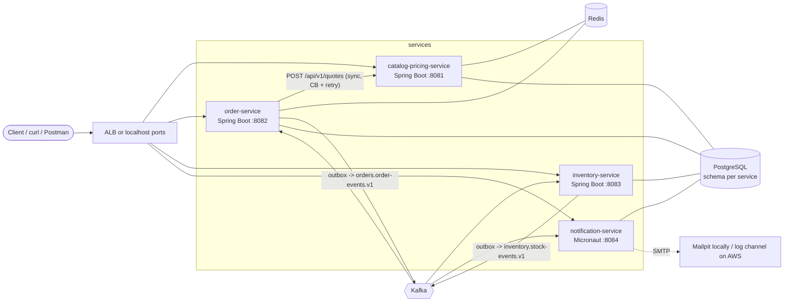
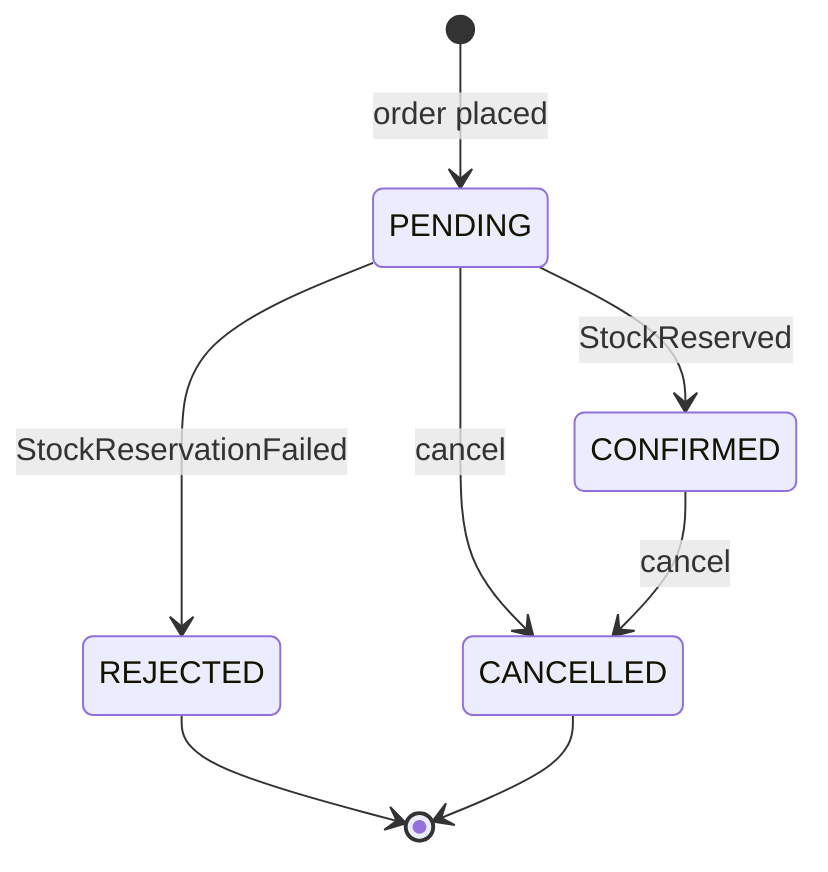
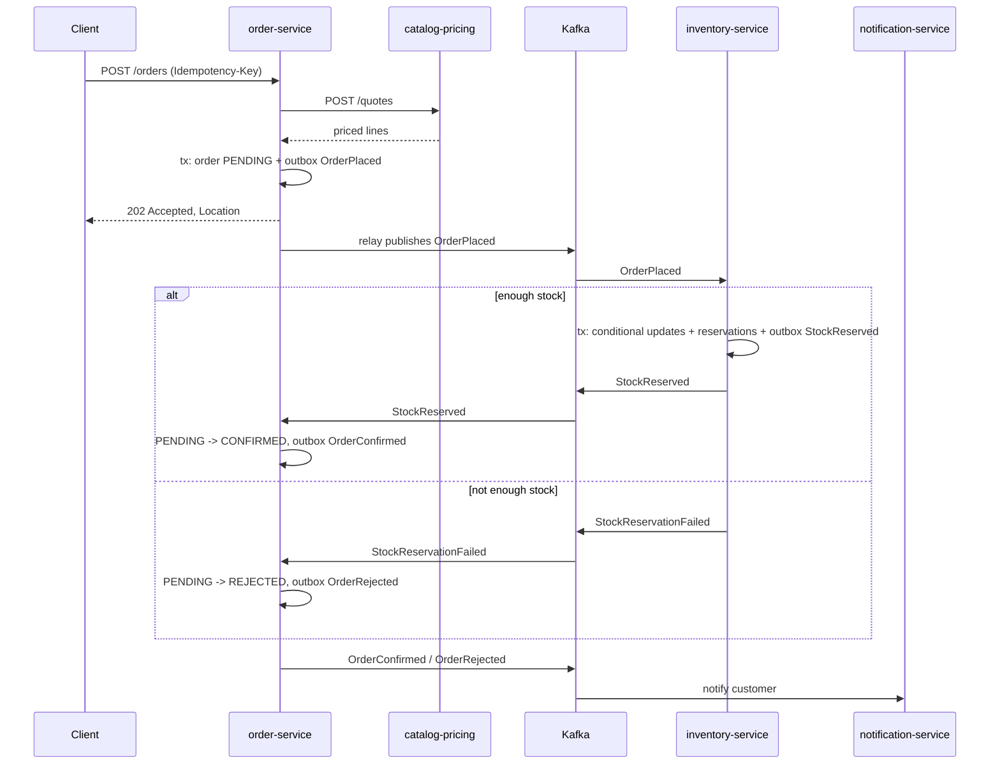

# OrderFlow – Architecture

Target architecture for a B2B/B2C e-commerce backend with four independently deployable services. The scope is intentionally limited to catalog, ordering, inventory and notifications.

## 1. Scope

In scope:

- Product catalog with B2C list prices and B2B customer-group price lists with volume tiers
- Order placement with idempotency, asynchronous stock reservation and cancellation
- Inventory that never oversells under concurrent load
- Customer notifications driven by events
- Local run with Docker Compose, CI on GitHub Actions, a real (temporary) deployment to AWS ECS Fargate

Out of scope (deliberately): payments, shipping, UI, search, multi-currency conversion, full auth (optional stretch phase).

## 2. Tech stack

| Area | Choice | Notes |
|---|---|---|
| Language | Java 25 (LTS) | Micronaut 5 requires Java 25, so all services use it |
| Main framework | Spring Boot 4.1.x | catalog-pricing, order, inventory |
| Second framework | Micronaut 5.x | notification-service |
| Build | Maven (wrapper per service) + root aggregator pom | |
| Database | PostgreSQL 17, one schema per service, Flyway migrations | |
| Persistence | Spring Data JPA / Hibernate; Micronaut Data JDBC | |
| Cache / keys | Redis 7 (Spring Cache + idempotency keys) | |
| Messaging | Apache Kafka 4.x (KRaft, no ZooKeeper), Spring Kafka, Micronaut Kafka | |
| HTTP client | Spring HTTP interface (`@HttpExchange`) on `RestClient` | |
| Resilience | Resilience4j circuit breaker + retry | If the Boot 4 starter is not compatible, use `resilience4j-circuitbreaker` core programmatically |
| API | REST, JSON, `/api/v1`, Bean Validation, RFC 9457 `ProblemDetail`, springdoc-openapi | |
| Testing | JUnit 5, AssertJ, Mockito, Testcontainers (Postgres, Kafka, Redis), WireMock | |
| Observability | Actuator health probes, Micrometer metrics, Micrometer Tracing (OTel), structured JSON logs | |
| Containers | Multi-stage Dockerfiles, `linux/arm64` images | M1 builds arm64 natively, Fargate runs ARM64 (Graviton) |
| CI/CD | GitHub Actions, OIDC to AWS, ECR, ECS rolling deploy with circuit breaker | |
| IaC | Terraform | |
| Cloud | AWS ECS Fargate, ALB, RDS PostgreSQL, ECS Service Connect, CloudWatch Logs, SSM Parameter Store | |

Versions: always take the latest patch of the listed minor from start.spring.io / micronaut.io / Maven Central at setup time and pin them. Do not trust version numbers from memory.

## 3. System overview



Communication rules:

- Synchronous HTTP only where the caller needs an answer immediately: order-service asks catalog-pricing-service for a price quote.
- Everything that changes state in another service goes through Kafka events.
- No service reads another service's schema.

## 4. Services

### 4.1 catalog-pricing-service (Spring Boot, port 8081, schema `catalog`)

Responsibility: products and prices. Stateless apart from its own schema.

Tables:

- `product(id uuid pk, sku varchar(32) unique, name, category, list_price_net numeric(12,2), vat_rate numeric(4,2), active boolean, created_at, updated_at)`
- `customer_group(code varchar pk)` with seed rows `B2C`, `B2B_STANDARD`, `B2B_GOLD`
- `price_list_entry(id uuid pk, customer_group_code fk, sku, min_qty int, unit_price_net numeric(12,2), valid_from date, valid_to date null)`, unique `(customer_group_code, sku, min_qty, valid_from)`

Pricing rule (pure domain code, fully unit tested):

1. Take entries for the customer group and SKU that are valid today.
2. Pick the entry with the highest `min_qty <= quantity`.
3. If none, use `list_price_net`.
4. Money is `BigDecimal`, scale 2, `RoundingMode.HALF_EVEN`, currency EUR.
5. B2C responses also include gross amounts (net × (1 + vat_rate)); B2B responses show net and VAT separately.

Endpoints:

| Method | Path | Notes |
|---|---|---|
| GET | `/api/v1/products?category=&page=&size=` | Paged |
| GET | `/api/v1/products/{sku}` | 404 as ProblemDetail |
| POST | `/api/v1/products` | Admin, validated |
| PUT | `/api/v1/products/{sku}/prices` | Replaces tier list for a group, evicts cache |
| POST | `/api/v1/quotes` | Side-effect free; used by order-service |

Quote request/response:

```json
// request
{ "customerGroup": "B2B_GOLD", "lines": [ { "sku": "CHAIR-001", "quantity": 25 } ] }
// response
{
  "customerGroup": "B2B_GOLD",
  "currency": "EUR",
  "lines": [ { "sku": "CHAIR-001", "quantity": 25, "unitPriceNet": 79.90, "lineTotalNet": 1997.50, "appliedRule": "TIER_MIN_QTY_20" } ],
  "totalNet": 1997.50, "totalVat": 539.33, "totalGross": 2536.83,
  "quotedAt": "2026-10-01T10:15:30Z"
}
```

Caching: the resolved tier list per `(customerGroup, sku)` is cached in Redis via `@Cacheable("price-tiers")`, JSON serialization, TTL 10 minutes, evicted by `@CacheEvict` on price update. Cache-aside with TTL and explicit eviction bounds staleness by the TTL if eviction is missed.

### 4.2 order-service (Spring Boot, port 8082, schema `orders`)

Responsibility: customers (minimal), orders, order state machine, orchestrating nothing directly (choreographed saga).

Tables:

- `customer(id uuid pk, name, email, type varchar check in ('B2C','B2B'), customer_group_code)`, seeded with a few customers
- `orders(id uuid pk, customer_id fk, status, currency, total_net, total_vat, total_gross, created_at, updated_at, version bigint)`
- `order_line(id uuid pk, order_id fk, sku, quantity, unit_price_net, line_total_net)`
- `outbox_event(id uuid pk, aggregate_type, aggregate_id, event_type, payload jsonb, headers jsonb null, created_at, published_at null)` with partial index on `published_at is null`; `headers` carries the trace context (`traceparent`) so the relay can continue the trace
- `processed_event(event_id uuid pk, processed_at)`

State machine (enforced in the domain entity, not in controllers):



Endpoints:

| Method | Path | Notes |
|---|---|---|
| POST | `/api/v1/orders` | Requires `Idempotency-Key` header; returns `202 Accepted`, `Location`, status `PENDING` |
| GET | `/api/v1/orders/{id}` | Includes lines and status |
| GET | `/api/v1/orders?customerId=&status=&page=&size=` | Paged; lines loaded without N+1 (fetch join or `@EntityGraph`, verified by a test counting queries) |
| POST | `/api/v1/orders/{id}/cancel` | Invalid transition returns 409 ProblemDetail |

Place-order flow:

1. Validate request (Bean Validation).
2. Idempotency: `SET idem:{customerId}:{key} IN_PROGRESS NX EX 86400` in Redis. If the key exists with a stored result, return the same response. If it exists with a different request hash, return 422. If `IN_PROGRESS`, return 409.
3. Call catalog-pricing `POST /api/v1/quotes` through the HTTP interface client. Timeouts: connect 1 s, read 2 s. Retry: 2 attempts with backoff on connect errors and 5xx. Circuit breaker around it; when open, respond `503` ProblemDetail with `Retry-After`.
4. In one DB transaction: insert order + lines with status `PENDING`, insert `OrderPlaced` into `outbox_event`.
5. Store the result under the idempotency key.

Why the quote call is outside the transaction: never hold a DB connection while waiting on the network.

### 4.3 inventory-service (Spring Boot, port 8083, schema `inventory`)

Responsibility: stock levels and reservations. Owner of the "no overselling" invariant.

Tables:

- `stock_item(sku varchar pk, on_hand int, reserved int, low_stock_threshold int, low_stock_notified boolean, version bigint, updated_at)` with `check (reserved >= 0 and reserved <= on_hand)`
- `reservation(id uuid pk, order_id uuid, sku, quantity, status varchar check in ('RESERVED','RELEASED'), created_at)`, unique `(order_id, sku)`
- `outbox_event`, `processed_event` (same shape as order-service)
- `shedlock` table for scheduled job locking

Reservation algorithm:

```sql
UPDATE stock_item
   SET reserved = reserved + :qty, version = version + 1, updated_at = now()
 WHERE sku = :sku AND on_hand - reserved >= :qty;
```

- Process order lines sorted by SKU so two concurrent orders lock rows in the same order (no deadlocks).
- If any update affects 0 rows, throw, roll back the whole transaction, then in a new transaction record `StockReservationFailed` in the outbox and mark the event processed.
- All-or-nothing per order.
- The DB check constraint is the last line of defence.

Alternatives: `SELECT ... FOR UPDATE` (pessimistic), JPA `@Version` optimistic locking with retry, Redis `DECRBY` counters. The conditional update uses one round trip per line, prevents lost updates and avoids retry storms on hot SKUs.

Endpoints:

| Method | Path | Notes |
|---|---|---|
| GET | `/api/v1/stock/{sku}` | on_hand, reserved, available |
| PUT | `/api/v1/stock/{sku}` | Admin restock; resets `low_stock_notified` when above threshold |
| GET | `/api/v1/reservations?orderId=` | Operational inspection |

Scheduled jobs:

- Outbox relay (see 5.3).
- Low-stock scan every 5 minutes (`@Scheduled(cron)`, guarded by ShedLock so only one ECS task runs it): emits `LowStock` once per threshold crossing.

### 4.4 notification-service (Micronaut, port 8084, schema `notifications`)

Responsibility: turn business events into customer and ops notifications. Uses Micronaut Kafka and Micronaut Data JDBC.

- Micronaut Kafka `@KafkaListener` on both topics, handling `OrderConfirmed`, `OrderRejected`, `OrderCancelled`, `LowStock`
- Micronaut Data JDBC + Flyway, table `notification(id uuid pk, event_id uuid unique, order_id uuid null, type, recipient, subject, body, channel, created_at)`
- Idempotency: `INSERT ... ON CONFLICT (event_id) DO NOTHING`; send only if the insert happened
- Channel `SMTP` (Micronaut Email + JavaMail to Mailpit) locally, channel `LOG` on AWS, selected by config
- `GET /api/v1/notifications?orderId=` for inspection
- Customer email arrives inside the event payload (event-carried state transfer), so this service never calls order-service

## 5. Messaging

### 5.1 Topics

| Topic | Producer | Consumers | Key | Partitions |
|---|---|---|---|---|
| `orders.order-events.v1` | order-service | inventory-service, notification-service | orderId | 3 |
| `inventory.stock-events.v1` | inventory-service | order-service, notification-service | orderId (sku for LowStock) | 3 |
| `<topic>.DLT` | error handlers | none (inspect via Kafka UI) | same | 3 |

Keying by `orderId` guarantees per-order ordering: `OrderCancelled` can never overtake `OrderPlaced` for the same order.

Consumer groups: `inventory-service`, `order-service`, `notification-service`.

### 5.2 Event envelope

All events share one JSON envelope. Each service keeps its own copy of the event classes (no shared library); `contracts/events/*.json` holds one canonical sample per event and every consumer has a test that deserializes those samples.

```json
{
  "eventId": "7b0e...",
  "eventType": "OrderPlaced",
  "eventVersion": 1,
  "occurredAt": "2026-10-01T10:15:31Z",
  "aggregateId": "c1f2...",
  "payload": { }
}
```

Kafka headers: `eventType`, `traceparent` (propagated by Micrometer observation).

Payloads:

| Event | Payload fields |
|---|---|
| OrderPlaced | orderId, customerId, customerType, lines[sku, quantity] |
| OrderConfirmed | orderId, customerId, customerEmail, totalGross, currency |
| OrderRejected | orderId, customerId, customerEmail, reason |
| OrderCancelled | orderId, customerId, customerEmail, previousStatus |
| StockReserved | orderId, lines[sku, quantity] |
| StockReservationFailed | orderId, reason, unavailableSkus[] |
| StockReleased | orderId |
| LowStock | sku, available, threshold |

Evolution rule: adding optional fields is allowed within `v1`; renaming or removing a field means a new event version and a period of dual publishing.

### 5.3 Transactional outbox

Problem: "save to DB, then send to Kafka" loses events if the process dies between the two steps, and "send, then save" publishes events for rolled-back changes.

Solution: the event row is written in the same transaction as the business change. A relay publishes it afterwards.

- Relay: `@Scheduled(fixedDelay = 500ms)`, reads up to 100 rows with `SELECT ... WHERE published_at IS NULL ORDER BY created_at FOR UPDATE SKIP LOCKED`, sends each with `KafkaTemplate`, waits for the ack, sets `published_at`.
- `SKIP LOCKED` lets several service instances run the relay without double-publishing the same batch.
- Guarantee: at-least-once (a crash after send but before `published_at` update republishes). Consumers are idempotent, so the end result is effectively-once.
- Producer config: `acks=all`, `enable.idempotence=true`.
- Cleanup: published rows older than 7 days deleted by a daily job.
- Production alternative: Debezium CDC on the outbox table.

### 5.4 Idempotent consumers and errors

- Each listener runs in a DB transaction: insert into `processed_event(event_id)`; if it already exists, skip; otherwise apply the change and write any resulting outbox event. Offset is committed after the listener returns.
- Spring Kafka `DefaultErrorHandler` with `FixedBackOff(1000 ms, 3)` and `DeadLetterPublishingRecoverer`. Deserialization and validation errors are non-retryable and go straight to the DLT.
- Micronaut: `@KafkaListener(errorStrategy = @ErrorStrategy(value = RETRY_ON_ERROR, retryCount = 3))` plus a DLT publish on final failure.

### 5.5 Saga (choreography)



Compensation: `OrderCancelled` makes inventory release the order's reservations and emit `StockReleased`. Late events are handled explicitly: a `StockReserved` arriving for an already `CANCELLED` order is ignored by order-service, and inventory releases because it also receives `OrderCancelled` (same key, same partition, so it arrives after `OrderPlaced`).

Why choreography and not an orchestrator: two participants and three outcomes. An orchestrator (or Temporal/Camunda) is the answer once the flow has payment, shipping and timeouts.

## 6. Cross-cutting concerns

API conventions:

- DTOs are Java records in an `api` package; entities never leave the service layer.
- Validation errors and business errors map to `ProblemDetail` in one `@RestControllerAdvice`, with a stable `type` URI per error (`https://orderflow.dev/problems/insufficient-stock` etc.).
- Pagination via `Pageable`, max page size 100.
- OpenAPI UI at `/swagger-ui.html` on Spring services.

Configuration:

- `application.yml` with profiles `local` (Compose) and `aws`. Secrets only from environment variables; on AWS they come from SSM Parameter Store through the ECS task definition.

Observability:

- Actuator: `health` with `liveness` and `readiness` groups (readiness includes DB and Kafka), `info`, `metrics`, `prometheus`.
- Structured JSON logs (`logging.structured.format.console=ecs`), traceId and spanId in every line.
- Micrometer Tracing with OpenTelemetry bridge; observation enabled on `KafkaTemplate` and listener containers so one trace spans HTTP -> outbox -> Kafka -> consumer.
- Custom metrics: `orders.placed`, `orders.rejected`, `inventory.reservation.failed`, `outbox.lag.seconds` (gauge: age of oldest unpublished row).
- Optional: `grafana/otel-lgtm` container in Compose to show traces and metrics.

Performance:

- Virtual threads on (`spring.threads.virtual.enabled=true`); database concurrency remains limited by the Hikari pool size.
- Hikari pool size: 10 per service.

## 7. Repository layout

```
orderflow/
├── README.md
├── pom.xml                         # aggregator only (packaging pom, lists modules)
├── contracts/events/               # one canonical JSON sample per event
├── docs/
│   └── ARCHITECTURE.md
├── infra/
│   ├── docker-compose.yaml         # infra + all services
│   ├── postgres/init.sql           # creates schemas
│   └── terraform/
├── scripts/
│   ├── smoke.sh                    # end-to-end curl + jq scenario
│   └── oversell-test.sh            # fires N parallel orders at one SKU
├── services/
│   ├── catalog-pricing-service/    # standalone Maven project with mvnw
│   ├── order-service/
│   ├── inventory-service/
│   └── notification-service/       # Micronaut
└── .github/workflows/
    ├── ci.yml
    └── deploy.yml
```

Package layout inside a Spring service (package by feature, thin layers inside):

```
com.orderflow.order
├── api            # controllers, request/response records, exception handler
├── application    # use-case services, transactions live here
├── domain         # entities, enums, domain rules (state machine, pricing rule)
├── infrastructure # JPA repositories, Kafka producer/consumer, outbox relay, HTTP clients, Redis
└── config
```

No ports-and-adapters interfaces unless there are two real implementations.
